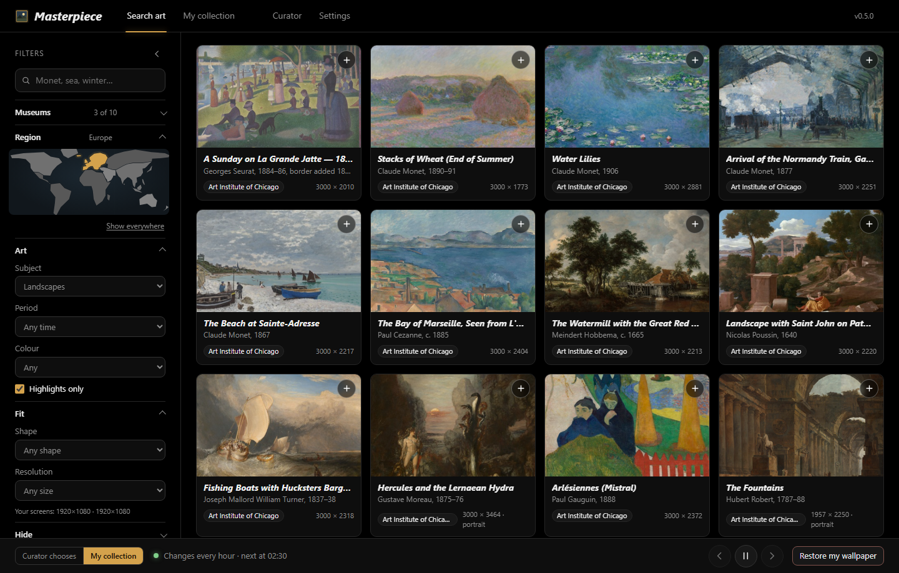

# Masterpiece

**Public-domain paintings as your Windows wallpaper**

Masterpiece searches the open-access collections of several museums at once, lets you
pick the paintings you like, and turns them into your Windows desktop background —
either as a rotating slideshow or as a single "painting of the day".



> **Not an official app.** Masterpiece is an independent open-source project. It is not
> made, endorsed or supported by any of the museums whose public APIs it uses.

## Features

- Search several museums in parallel, with an on/off toggle per museum
- Content filters: subject (landscapes, sea, cities, flowers, portraits, …), period,
  dominant colour, and *hide* religious scenes / nudes / death & war
- Screen-aware filters: "fits my screens" (also portrait monitors), "spans all my
  screens", "sharp on my screens" (no upscaling), or a fixed minimum width
- Multi-monitor: a matching painting per screen, the same one everywhere, or one
  painting spanned across all screens
- Preview paintings full-size before you select them
- Downloads your selection to `%USERPROFILE%\Pictures\Masterpiece`
- Optional label *title — artist · museum*, bottom-centre by default; drag it anywhere on a
  preview of your screens. Styles: dark or light box, museum plaque, text with shadow, subtle;
  sans or serif; three sizes; full text, two lines (title, then artist, year · museum), or less
- **Restore my wallpaper**: Masterpiece remembers what you had before (per-screen pictures,
  fit, colour or Windows slideshow) and puts it back; `python -m masterpiece stop` does the same
- Keeps the folder tidy: oldest files are removed above a maximum you choose
- Three ways to show them:
  - **Masterpiece rotation** (recommended) — a new painting every 10 min … once a day.
    Each screen gets a painting of matching shape, cropped to its exact resolution so the
    label stays visible. Runs as a per-user Windows scheduled task (`python -m masterpiece next`);
    stop it in the app or with `python -m masterpiece stop`.
  - **Windows slideshow** — Masterpiece switches on Windows' own shuffled slideshow for the folder.
  - **Just once** — set the wallpaper now, no rotation.
- A built-in "How it works" guide (shown on first start)
- Gentle on the museums' servers: search pages are cached for 6 hours, images and object
  data on disk, at most 4 simultaneous requests per museum, nothing is downloaded twice

Only public-domain / open-access works are shown.

## Install & run

Requires Windows 10/11 and Python 3.10+.

```powershell
git clone <repo-url> masterpiece
cd masterpiece
python -m venv .venv
.venv\Scripts\activate
pip install -e .
python -m masterpiece install  # Start-menu + desktop shortcut "Masterpiece"
python -m masterpiece          # opens http://127.0.0.1:8765 and a tray icon
```

After `install`, just double-click **Masterpiece**. It opens in its own app window (Edge
WebView2, built into Windows 11; without it Masterpiece uses your browser) and puts an icon next to
the clock. Closing the window keeps Masterpiece running in the tray. Tray menu: *Next painting*, *On screen now* (opens the museum page), *Pause rotation*,
*Restore my wallpaper*, *Start with Windows* and *Quit*. Starting it again while it runs
simply opens the app.

**My collection** (link at the top) shows the paintings you've saved, which ones are on screen
now, and lets you *show now*, *remove* or *never show again* (undo under "Hidden paintings").
Click a painting for its info card with the museum's description (Chicago, Cleveland) or facts (the Met).

- **♥ Favourite**: favourites come up about three times as often in the rotation.
- **Skip** (tray, collection, info card): removes the painting from your collection and puts
  another one on that screen; other screens keep theirs.
- **Match time of day** (rotation only): brighter paintings by day, darker ones in the evening.
- Changing the label (on/off, style, position) updates the paintings on screen right away.
- **Settings** page: screens, time of day, label, how many to keep, **lock screen** (the painting
  on the Windows lock screen too; your own picture comes back when you switch it off), start with
  Windows, updates (check now, *install automatically* while you're away), and **storage**
  (what takes how much space, *Free up space*, open the folders).
- **Updates**: installed copies offer new versions from GitHub (*Install now*); after an update
  Masterpiece shows what's new.

### As a Windows program (Setup.exe)

```powershell
pip install -e .[build]
winget install JRSoftware.InnoSetup
python packaging\build.py --setup   # -> dist\Masterpiece-Setup-0.1.0.exe (≈14 MB, no Python needed)
```

The setup installs for the current user only (no admin rights) into
`%LOCALAPPDATA%\Programs\Masterpiece`, with a Start-menu entry, an optional desktop shortcut
and optional *Start with Windows*. Running a newer setup updates in place and keeps a running
rotation pointing at the new version. Uninstall via Windows Settings → Apps: it stops the
rotation, puts your previous wallpaper back and removes the shortcuts; your paintings and
settings are kept.

### Releasing an update

Installed copies check this repository's GitHub Releases (`UPDATE_REPO` in
`masterpiece/__init__.py`) about once a day and offer *Install now*. To publish one:

1. Raise `__version__` in `masterpiece/__init__.py` (and `version` in `pyproject.toml`).
2. `python packaging\build.py --setup`
3. On GitHub: *Releases → Draft a new release*, tag `v<version>`, write what's new, and attach
   `dist\Masterpiece-Setup-<version>.exe` and its `.sha256` file. Publish.

The app only installs a Setup whose SHA-256 matches the checksum GitHub publishes for it
(or the `.sha256` file), downloaded over HTTPS from GitHub. Drafts and pre-releases are ignored.

Neither file is code-signed, so Windows shows "Windows protected your PC" the first time:
*More info → Run anyway*. The same commands work with the .exe (`Masterpiece.exe next`, `stop`, …).

Other commands:

```powershell
python -m masterpiece serve --port 9000 --no-browser
python -m masterpiece daily     # set a random downloaded painting as wallpaper
```

Settings are stored in `%APPDATA%\Masterpiece\settings.json` (never in the repo).

## Sources & licences

| Museum | API | Key | Licence of images used |
|---|---|---|---|
| [Art Institute of Chicago](https://www.artic.edu/open-access) | [api.artic.edu](https://api.artic.edu/docs/) | none | CC0 (public-domain works only) |
| [Cleveland Museum of Art](https://www.clevelandart.org/open-access) | [openaccess-api.clevelandart.org](https://openaccess-api.clevelandart.org/) | none | CC0 |
| [Rijksmuseum](https://www.rijksmuseum.nl/) | [data.rijksmuseum.nl](https://data.rijksmuseum.nl/) | none | Public Domain Mark / CC0 |
| [SMK – National Gallery of Denmark](https://open.smk.dk/) | [api.smk.dk](https://api.smk.dk/api/v1/) | none | Public Domain Mark |
| [The Metropolitan Museum of Art](https://www.metmuseum.org/hubs/open-access) | [collectionapi.metmuseum.org](https://metmuseum.github.io/) | none | CC0 (Open Access) |
| [Japan Search](https://jpsearch.go.jp/) (Tokyo Museum Collection and others) | jpsearch.go.jp/api | none | Public Domain Mark only; images ≈1000 px |
| [National Gallery of Art, Washington](https://www.nga.gov/open-access-images.html) | [open data on GitHub](https://github.com/NationalGalleryOfArt/opendata) (no search API: a local index of ≈2900 paintings ships with the app, `packaging/nga_index.py`) | none | CC0 (open-access images) |
| [Yale Center for British Art](https://britishart.yale.edu/) & [Yale University Art Gallery](https://artgallery.yale.edu/) | [LUX](https://lux.collections.yale.edu/) (Linked Art) + IIIF manifests | none | Only works marked "Copyright Statement: Public domain" |

The **Region** filter (Europe, the Americas, East & South Asia, Middle East & Islamic world)
works across museums; the Met adds Chinese & Japanese paintings, Japanese woodblock prints
and Persian/Mughal manuscript paintings. Museums with little from a region are skipped.

Planned: Europeana and Paris Musées (both need a free personal key, which would be entered in
the app and never stored in the repository).

Local data: settings in `%APPDATA%\Masterpiece`, cache / originals / current renders in
`%LOCALAPPDATA%\Masterpiece` (safe to delete), paintings in `Pictures\Masterpiece`.

Artwork metadata is provided by the museums under their own terms (mostly CC0; AIC
descriptions are CC BY 4.0). Please credit the museum when you share an image.

## How it works

```
masterpiece/
  sources/        one adapter per museum, same interface:
                  search(query, page, color, top_only, subject, period, hide) -> list[Artwork]
  models.py       shared Artwork format
  content.py      subject / period / hide definitions, mapped per source
  filters.py      source-independent filters (size, shape, screens, hide)
  monitors.py     monitor layout + per-monitor wallpaper (IDesktopWallpaper)
  search.py       queries enabled sources in parallel and interleaves results
  wallpaper.py    download, label (Pillow), clean up, set wallpaper (Win32)
  server.py       small local web server (127.0.0.1 only) + image proxy
  web/            the UI (vanilla HTML/CSS/JS)
```

Adding a museum = one new file in `masterpiece/sources/` plus one line in
`sources/__init__.py`.

## Development

```powershell
pip install -e .[dev]
pytest -m "not live"   # offline tests
pytest                 # including live API tests
```

## Licence

[MIT](LICENSE)
